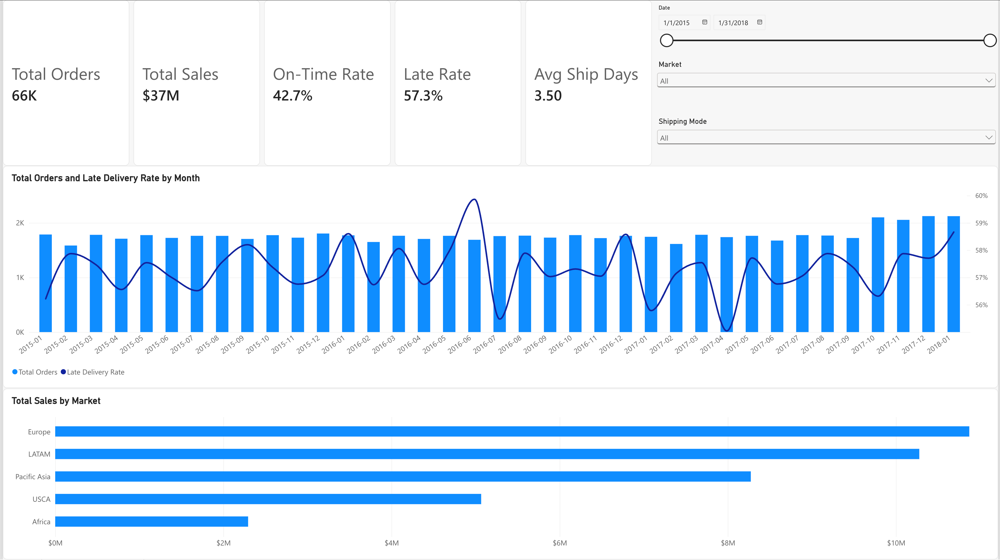
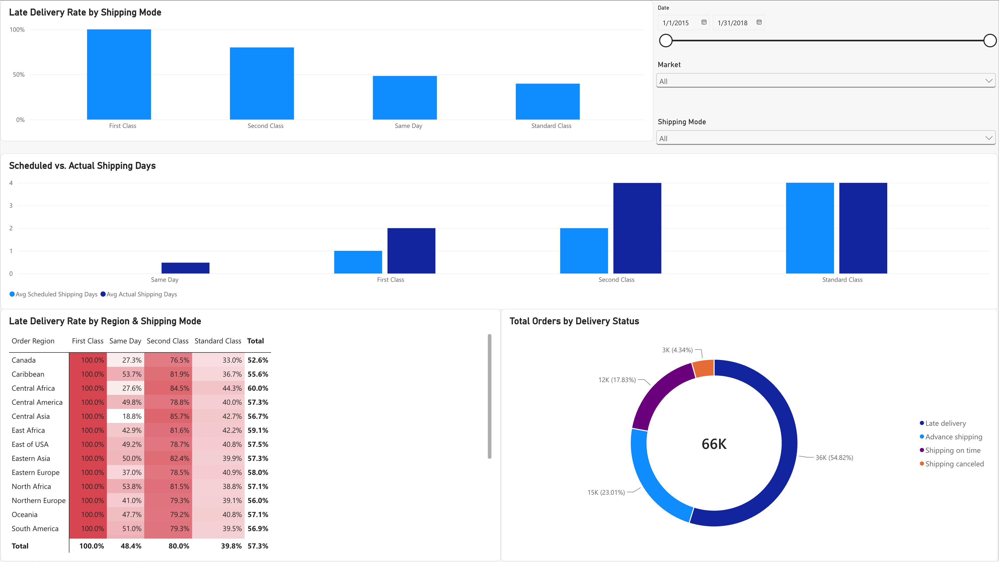

# Supply Chain Delivery Performance Dashboard (Power BI)

An interactive Power BI dashboard analyzing **180K+ order records** to find out why more than half of all orders are delivered late, and what to do about it.



## Key Findings

**1. Premium shipping modes have unrealistic delivery promises**
First Class is late on **100%** of orders: it promises 1 day but always takes 2. Second Class (**80%** late) promises 2 days but averages ~4.
→ *Recommendation:* Recalibrate promised delivery windows to match actual carrier performance, or renegotiate carrier SLAs.

**2. Shipping mode, not region, drives delays**
Late rates vary only slightly across regions (**52.6%–60.0%**), but range from **39.8%** (Standard Class) to **100%** (First Class) across shipping modes.
→ *Recommendation:* Prioritize process fixes by shipping mode globally rather than region-specific carrier changes.

**3. Delays are persistent and affect all product categories**
The monthly late rate stayed at 55–59% for three years, and top categories such as Fishing and Cleats all sit at ~57%.
→ *Recommendation:* Track on-time rate by shipping mode as a monthly KPI, starting with high-revenue categories and the Consumer segment (50%+ of sales).

## Dashboard Pages

| Page | What it shows |
|---|---|
| Overview | KPIs (orders, sales, on-time rate, late rate, avg shipping days), monthly trend, sales by market |
| Delivery Analysis | Late rate by shipping mode, scheduled vs. actual days, region × shipping mode heatmap, delivery status mix |
| Product & Customer | Top 10 categories by sales and profit, sales vs. late rate by category, sales by customer segment |
| Insights | Key findings and recommendations |



## Tools & Techniques

- **Power Query:** fixed file encoding (Windows-1252 → UTF-8), removed PII and unused columns, converted data types
- **Data modeling:** built a dedicated date table and a one-to-many relationship to the orders table
- **DAX measures:** distinct order counts, late/on-time rates, average shipping and delay days, profit margin
- **Visualization:** KPI cards, combo charts, conditional-formatting heatmap, scatter plot, synced slicers

## Metric Definitions

- **Total Orders** counts distinct `Order Id`s. The raw data is at order-line level (~180K rows ≈ 66K orders).
- **Late Delivery Rate** = late orders ÷ valid orders. Canceled orders are excluded from the denominator.
- **On-Time Delivery Rate** = 1 − Late Delivery Rate.

```DAX
Total Orders = DISTINCTCOUNT(Orders[Order Id])

Late Delivery Rate = DIVIDE([Late Orders], [Valid Orders])

Avg Days Late =
AVERAGEX(
    FILTER(Orders, Orders[Late_delivery_risk] = 1),
    Orders[Days for shipping (real)] - Orders[Days for shipment (scheduled)]
)
```

## Files

- `Supply_Chain_Dashboard.pbix`: Power BI source file (open with Power BI Desktop)
- `Supply_Chain_Dashboard.pdf`: static export of all four pages
- `*.png: page screenshots

## Data Source

DataCo Smart Supply Chain for Big Data Analysis, by Fabian Constante, Fernando Silva and António Pereira (Mendeley Data, DOI: [10.17632/8gx2fvg2k6](https://data.mendeley.com/datasets/8gx2fvg2k6/5)), also available on [Kaggle](https://www.kaggle.com/datasets/shashwatwork/dataco-smart-supply-chain-for-big-data-analysis). The raw dataset is not included in this repo; download it from the links above.

*Note: The dataset appears to be partly simulated (e.g., First Class always takes exactly 2 days), so some figures are more extreme than in real operations. The underlying pattern of delivery promises not matching carrier capability is common in practice.*

---

Built by **Qihong Li** · [LinkedIn](https://www.linkedin.com/in/your-profile)
